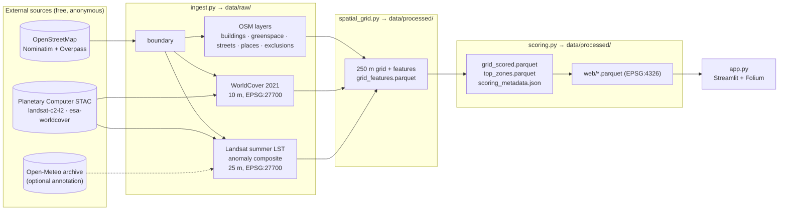

# Edinburgh Urban Heat Island & Green Space Optimizer — Architecture

> **Status:** Blueprint v1.0 · **Audience:** implementers (human or AI) building one module at a time · **Companion:** [`docs/TASKS.md`](TASKS.md)
>
> This document is the **single source of truth** for file names, column names, CRS rules, constants and formulas. If `TASKS.md` and this file ever disagree, this file wins. Fix the other one.

---

## 0. What we are building

A reproducible Python pipeline that answers one question for the City of Edinburgh:

> **"Where would new trees, green roofs or depaved pocket parks cool the most people-exposed, heat-stressed surfaces, and where are those places far from any existing cooling greenspace?"**

It ingests open satellite and map data, builds a 250 m × 250 m analysis grid in British National Grid, scores every urban cell with a transparent **Greening Priority Score (0–100)**, extracts the **top 15 spatially distinct micro-zones** with a named street corridor and intervention type, and presents them in a Streamlit + Folium dashboard tuned for a 15-second LinkedIn screen recording.

### 0.1 Design principles

| # | Principle | Consequence in code |
|---|-----------|---------------------|
| P1 | **Zero-cost, zero-manual-download** | Every input comes from an anonymous HTTP API (Planetary Computer STAC, Nominatim/Overpass via OSMnx, optional Open-Meteo). No accounts, no API keys, no clicking "download". |
| P2 | **Reproducible** | Satellite scene IDs are pinned in a committed manifest; OSM extracts are cached; every processed artifact records its inputs in a metadata JSON. |
| P3 | **Idempotent, cache-first** | Each ingest step is skipped if its output exists, unless `--force`. Writes are atomic (temp file + rename). |
| P4 | **Compute in metres, display in degrees** | All geometry maths in `EPSG:27700`. `EPSG:4326` only at the edges: ingestion and web export (§4). |
| P5 | **Pure, testable core** | `scoring.py` is pure functions over DataFrames (no I/O inside formulas). Tests use synthetic geometry and never hit the network. |
| P6 | **Thin app** | `app.py` reads only small, pre-computed files in `data/processed/web/`. It never imports `ingest`, `osmnx` or `odc.stac`. |
| P7 | **Explainable output** | Every score breaks down into three additive contributions shown in the UI. Every bound and weight lives in `config.py` and is echoed in `scoring_metadata.json`. |

---

## 1. System overview



### 1.1 Module responsibilities and allowed imports

| Module | Responsibility | May import (project) | Must NOT import |
|--------|---------------|----------------------|-----------------|
| `config.py` | Paths, CRS constants, thresholds, weights, tag dictionaries, tiny pure helpers (`snap_bounds`) | nothing | anything heavy (keep import < 50 ms) |
| `ingest.py` | Network I/O → `data/raw/` | `config` | `scoring`, `app` |
| `spatial_grid.py` | Grid generation, raster/vector aggregation, CRS guards, web reprojection helper | `config` | `ingest`, `app` |
| `scoring.py` | Normalisation, scoring, eligibility, top-K selection, intervention typing, web export | `config`; `spatial_grid` (only `to_web`, `require_crs`) **imported lazily inside the functions that need them**, so `import edinburgh_uhi.scoring` stays light for the app | `ingest`, `app` |
| `app.py` | Page entry point: data loading, page config, wiring | `config`, `ui.*` | `ingest`, `spatial_grid`, `osmnx`, `odc.stac`, `pystac_client` |
| `ui/` | Presentation layer (§7.9): `theme`, `components` (pure builders), `map_view`, `model`, `panel`, `state` | `config`, `scoring` (pure functions only), each other | same as `app.py`; `components` and `model` also must not import `streamlit` |

Dependency direction is strictly `config ← ingest`, `config ← spatial_grid ← scoring ← ui ← app`. No cycles.

### 1.2 Run sequence

```bash
uv run python -m edinburgh_uhi.ingest --step all      # network; minutes; cached after first run
uv run python -m edinburgh_uhi.spatial_grid           # offline; builds grid features
uv run python -m edinburgh_uhi.scoring                # offline; scores, ranks, exports web layers
uv run streamlit run src/edinburgh_uhi/app.py         # offline; reads data/processed/web/
```

---

## 2. Artifact map (data contracts)

Every file the pipeline writes. Column-level schemas are in §5.4, §6.8 and §3.4.

| Path | Format | CRS | Producer | Consumer | In git? |
|------|--------|-----|----------|----------|---------|
| `data/raw/edinburgh_boundary.parquet` | GeoParquet, 1 row | 4326 | ingest | ingest, spatial_grid | no |
| `data/raw/osm_buildings.parquet` | GeoParquet (Polygon/MultiPolygon) | 4326 | ingest | spatial_grid | no |
| `data/raw/osm_greenspace.parquet` | GeoParquet (Polygon/MultiPolygon) | 4326 | ingest | spatial_grid | no |
| `data/raw/osm_streets.parquet` | GeoParquet (LineString) | 4326 | ingest | spatial_grid | no |
| `data/raw/osm_places.parquet` | GeoParquet (Point) | 4326 | ingest | spatial_grid | no |
| `data/raw/osm_exclusions.parquet` | GeoParquet (Polygon/MultiPolygon) | 4326 | ingest | spatial_grid | no |
| `data/raw/worldcover_2021_27700_10m.tif` | GeoTIFF uint8, DEFLATE | 27700 | ingest | spatial_grid | no |
| `data/raw/landsat_summer_lst_27700_25m.tif` | GeoTIFF float32 ×3 bands, DEFLATE | 27700 | ingest | spatial_grid | no |
| `data/raw/lst_scene_manifest.json` | JSON | — | ingest | ingest (pinning), scoring (metadata) | **yes** |
| `data/processed/greenspace_dissolved.parquet` | GeoParquet | 27700 | spatial_grid | scoring (web export) | yes |
| `data/processed/cell_main_streets.parquet` | GeoParquet (MultiLineString) | 27700 | spatial_grid | scoring | yes |
| `data/processed/grid_features.parquet` | GeoParquet | 27700 | spatial_grid | scoring | yes |
| `data/processed/grid_scored.parquet` | GeoParquet | 27700 | scoring | analysis, README | yes |
| `data/processed/top_zones.parquet` | GeoParquet | 27700 | scoring | analysis, README | yes |
| `data/processed/scoring_metadata.json` | JSON | — | scoring | app (KPIs, provenance) | yes |
| `data/processed/web/grid_web.parquet` | GeoParquet, urban cells only | 4326 | scoring | app | yes |
| `data/processed/web/parks_web.parquet` | GeoParquet, simplified | 4326 | scoring | app | yes |
| `data/processed/web/corridors_web.parquet` | GeoParquet, eligible cells' main streets | 4326 | scoring | app | yes |
| `data/processed/web/zones_web.parquet` | GeoParquet, top-K | 4326 | scoring | app | yes |

**Why commit `data/processed/`:** Streamlit Community Cloud must not run a multi-minute network ingest on cold start. The processed outputs are small (target < 15 MB total, `web/` < 5 MB) and make the repo clone-and-run. `data/raw/` stays ignored except the scene manifest, which is the reproducibility anchor.

`.gitignore` additions:

```gitignore
data/raw/*
!data/raw/.gitkeep
!data/raw/lst_scene_manifest.json
data/raw/.osmnx_cache/
```

---

## 3. Data acquisition — `ingest.py`

### 3.1 Choosing a land surface temperature (LST) source

| Option | Resolution | Cost / access | Verdict |
|--------|-----------|---------------|---------|
| **Landsat 8/9 Collection 2 Level-2 Surface Temperature via Microsoft Planetary Computer STAC** | 100 m thermal, delivered on a 30 m grid | Free, anonymous; asset URLs are signed with the `planetary-computer` package | ✅ **Primary.** Fine enough to tell street blocks apart, analysis-ready (atmospherically corrected, in Kelvin), and has a decade of summer archive. |
| Open-Meteo (forecast / historical archive) | Kilometre-scale model grids; the archive's reanalysis is coarser | Free, no key | ❌ **Not used as the heat layer.** At 250 m, dozens of cells would share one model value, so it cannot show intra-urban hotspots. ✅ **Used optionally** to record the daily max air temperature for each Landsat scene date (context for the KPI caption, optional "warm-day" filter). |
| ECOSTRESS (70 m) | Finer | Requires NASA Earthdata login | ❌ Breaks P1 (needs an account). Listed as a future extension. |
| Sentinel-3 SLSTR / MODIS LST | ~1 km | Free | ❌ Too coarse for 250 m cells. |

**Landsat facts the code relies on:**
- STAC endpoint: `https://planetarycomputer.microsoft.com/api/stac/v1`, collection `landsat-c2-l2`.
- Thermal asset key: `lwir11` (= `ST_B10`), `uint16`, nodata `0`.
- Pixel QA asset key: `qa_pixel` (= `QA_PIXEL`).
- Scale to Kelvin: `K = DN × 0.00341802 + 149.0` (USGS Collection 2 surface temperature scaling). Then `°C = K − 273.15`.
- Native CRS for Edinburgh scenes is UTM zone 30N (`EPSG:32630`). We never write data in that CRS: `odc-stac` resamples straight into the BNG analysis grid at load time (§4).

### 3.2 Landsat LST pipeline (step `lst`)

**Libraries:** `pystac-client`, `planetary-computer`, `odc-stac` (+ `odc-geo`), `rioxarray`, `xarray`, `numpy`.
`odc-stac` was picked over a hand-rolled `rioxarray` mosaic because it reprojects, mosaics same-day path/row overlaps (`groupby="solar_day"`), and snaps to a caller-defined pixel grid in one call. `rioxarray` is still used to clip and to write the GeoTIFF.

**3.2.1 Scene discovery (only when no manifest exists or `--refresh-manifest`)**

```text
for year in LST_YEARS (2019..2025 inclusive):
    search(collections=["landsat-c2-l2"],
           bbox=boundary_bbox_4326,                     # STAC bbox must be WGS84
           datetime=f"{year}-06-01/{year}-08-31",       # meteorological summer
           query={"eo:cloud_cover": {"lt": 40},
                  "platform": {"in": ["landsat-8", "landsat-9"]}})
keep items whose `landsat:collection_category` == "T1" (filter client-side if the server-side query is unsupported)
```

- Open the client with `modifier=planetary_computer.sign_inplace` for discovery, but **never store signed URLs**. SAS tokens expire.
- Write `data/raw/lst_scene_manifest.json`:

```json
{
  "created_utc": "2026-11-13T10:00:00Z",
  "stac_url": "https://planetarycomputer.microsoft.com/api/stac/v1",
  "collection": "landsat-c2-l2",
  "query": {"years": [2019, 2025], "months": [6, 7, 8], "max_scene_cloud": 40},
  "scenes": [
    {"id": "LC08_L2SP_...", "datetime": "...", "platform": "landsat-8",
     "eo_cloud_cover": 12.3, "boundary_clear_frac": 0.81, "used": true,
     "air_tmax_c": 21.4}
  ]
}
```

**3.2.2 Pinned reload (default path once the manifest exists).** Re-fetch items with `search(ids=[...used and candidate ids...])`. This makes the composite reproducible even as the catalog changes. Commit the manifest.

**3.2.3 Load onto the analysis pixel grid**

1. Load the boundary and reproject it to 27700. Compute `extent = snap_bounds(boundary_bng.total_bounds, GRID_CELL_M)` (floor/ceil to multiples of 250 m; see `config.snap_bounds`).
2. Build an `odc.geo` `GeoBox` covering `extent` in `EPSG:27700` at `LST_RES_M = 25` m. **Assert** that the GeoBox origin sits on a multiple of 250 m, so each 250 m cell holds exactly 10 × 10 pixels.
3. `odc.stac.load(items, bands=["lwir11", "qa_pixel"], geobox=gbox, resampling={"lwir11": "bilinear", "qa_pixel": "nearest"}, groupby="solar_day", patch_url=planetary_computer.sign)`.
   QA must be resampled with **nearest**. Bilinear on bit flags produces garbage.

**3.2.4 Masking and scaling (per scene `s`)**

`QA_PIXEL` bits for Landsat 8/9 Collection 2: a pixel is **invalid** if any of these bits is set:

| Bit | Meaning |
|-----|---------|
| 0 | Fill |
| 1 | Dilated cloud |
| 2 | Cirrus |
| 3 | Cloud |
| 4 | Cloud shadow |
| 5 | Snow |
| 7 | Water (excluded so the Firth of Forth and lochs don't drag the median down) |

```text
mask_bits   = sum(1 << b for b in LST_QA_MASK_BITS)          # (0,1,2,3,4,5,7)
valid_s     = (lwir11 != 0) & ((qa_pixel & mask_bits) == 0) & inside_boundary
lst_c_s     = where(valid_s, lwir11 * 0.00341802 + 149.0 - 273.15, NaN)
clear_frac_s = count(valid_s) / count(inside_boundary)
```

Drop scene `s` if `clear_frac_s < LST_MIN_SCENE_CLEAR_FRAC` (default 0.5). Record `boundary_clear_frac` and `used` in the manifest.

**3.2.5 Per-scene anomaly, then composite (the key methodological choice)**

Absolute LST varies a lot between scenes (a 17 °C day and a 27 °C day). Taking a median of absolute LST across scenes mixes weather with geography. We **standardise each scene first**:

$$
\Delta T_s(p) = LST_s(p) - \operatorname{median}_{q \in \text{boundary},\ \text{valid}_s} LST_s(q)
$$

$$
\Delta T(p) = \operatorname{median}_s \Delta T_s(p), \qquad
LST(p) = \operatorname{median}_s LST_s(p), \qquad
n(p) = \#\{s : \text{valid}_s(p)\}
$$

Fail loudly if fewer than `LST_MIN_SCENES` (default 3) scenes survive. The error message should suggest widening `LST_YEARS` or raising `LST_MAX_SCENE_CLOUD`.

**3.2.6 Output:** `data/raw/landsat_summer_lst_27700_25m.tif`, float32, nodata `NaN`, DEFLATE, tiled, with band descriptions:

| Band | Name | Unit |
|------|------|------|
| 1 | `lst_anomaly_c` | °C, relative to that scene's city median |
| 2 | `lst_c` | °C, median summer daytime surface temperature |
| 3 | `n_obs` | count of clear observations |

**3.2.7 Optional Open-Meteo annotation (`LST_ANNOTATE_AIR_TEMP = True`).** For each used scene date, call the Open-Meteo historical archive (daily `temperature_2m_max` at Edinburgh's centroid, `timezone=Europe/London`) and store `air_tmax_c` in the manifest. If `LST_MIN_AIR_TMAX_C` is set (default `None`), drop scenes from cooler days. Network failure here must **never** fail the pipeline: log a warning and leave `air_tmax_c` as `null`.

### 3.3 ESA WorldCover (step `worldcover`)

Gives us an impervious proxy that **doesn't depend on OSM completeness**, plus a water mask and a tree-cover fraction.

- Collection `esa-worldcover`, asset `map`, year 2021 (v200). Search with `datetime="2021-01-01/2021-12-31"`.
- Load with `odc.stac.load` onto a 10 m GeoBox over the **same snapped extent** (250 / 10 = 25 pixels per cell) with `resampling="nearest"` (categorical).
- Write `data/raw/worldcover_2021_27700_10m.tif` (uint8, nodata 0).
- Classes used: `10` tree cover, `20` shrubland, `30` grassland, `50` built-up, `80` permanent water, `90` herbaceous wetland.

### 3.4 OpenStreetMap layers (steps `boundary`, `osm`)

**Library:** `osmnx >= 2.0` (2.x API: `geocode_to_gdf`, `features_from_polygon`, `graph_from_polygon`, `graph_to_gdfs`).

**Global OSMnx settings** (set once in `ingest._configure_osmnx()`):

```python
ox.settings.use_cache = True
ox.settings.cache_folder = str(config.OSMNX_CACHE_DIR)  # data/raw/.osmnx_cache
ox.settings.requests_timeout = 300
ox.settings.log_console = False
```

**3.4.1 Boundary.** `ox.geocode_to_gdf(config.PLACE_QUERY)`, where `PLACE_QUERY = "City of Edinburgh, Scotland, United Kingdom"`. After the first successful run, log the returned OSM relation ID and **pin it** in `config.BOUNDARY_OSM_ID` (e.g. `"R<id>"`). From then on, use `ox.geocode_to_gdf(BOUNDARY_OSM_ID, by_osmid=True)` so the geocoder can't silently return a different polygon.
Validate: exactly one row, Polygon/MultiPolygon, area in 27700 between `200 km²` and `450 km²` (the OSM council-area polygon may include part of the Forth; water is handled later via WorldCover). Store **only** `name`, `osm_id`, `geometry`.

**3.4.2 Feature layers.** Every query uses the boundary polygon in 4326 (`features_from_polygon`). This avoids a second geocode and guarantees all layers share one footprint.

| Layer | Tags (`config`) | Geometry filter | Kept columns |
|-------|-----------------|-----------------|--------------|
| buildings | `BUILDING_TAGS = {"building": True}` | Polygon, MultiPolygon | `osm_uid`, `building`, `geometry` |
| greenspace | `GREENSPACE_TAGS` (below) | Polygon, MultiPolygon | `osm_uid`, `green_type`, `name`, `access`, `geometry` |
| places | `PLACE_TAGS = {"place": ["suburb", "neighbourhood", "quarter"]}` | Point (use `representative_point()` for polygons) | `osm_uid`, `name`, `place`, `geometry` |
| exclusions | `EXCLUSION_TAGS = {"aeroway": ["aerodrome"], "landuse": ["railway", "quarry", "military"]}` | Polygon, MultiPolygon | `osm_uid`, `excl_type`, `geometry` |

```python
GREENSPACE_TAGS = {
    "leisure": ["park", "garden", "nature_reserve", "common", "recreation_ground", "golf_course"],
    "landuse": [
        "grass",
        "forest",
        "meadow",
        "village_green",
        "recreation_ground",
        "cemetery",
        "allotments",
    ],
    "natural": ["wood", "scrub", "heath", "grassland"],
}
```

Design notes:
- **This is a cooling-greenspace layer, not an access layer.** Golf courses, cemeteries and private gardens still cool their surroundings, so they're included. `access` is kept so the UI can label them. Sports pitches are excluded because many are artificial turf.
- **Why the exclusions layer exists:** Edinburgh Airport sits inside the council boundary. Hot, impervious and far from parks, it would take the #1 slot without this mask. The same applies to rail yards and quarries. Tree planting there isn't realistic.
- **Flattening OSMnx output.** In OSMnx 2.x, feature GeoDataFrames come with a MultiIndex of (element type, OSM id). `reset_index()`, then build `osm_uid = f"{element}/{id}"`. Detect the level names at runtime instead of hard-coding them. Derive `green_type` / `excl_type` as `"key=value"` from whichever tag matched.
- **Mixed and list-valued columns break Parquet.** Keep only the listed columns and cast them to `string` dtype.

**3.4.3 Street network.**

```python
G = ox.graph_from_polygon(
    boundary_poly_4326,
    custom_filter='["highway"~"^(primary|secondary|tertiary|residential|unclassified|living_street|pedestrian)$"]',
    simplify=True,
    retain_all=True,
    truncate_by_edge=True,
)
edges = ox.graph_to_gdfs(G, nodes=False).reset_index()
```

Normalise list-valued attributes before saving: `name` (list → `" / ".join`), `highway` (list → first element), `osmid` (list → comma-joined string `osm_ids`). Keep `u, v, key, osm_ids, name, highway, geometry`. Lengths are recomputed in BNG later. Don't trust the stored `length`.

Motorway and trunk roads are excluded on purpose. They aren't realistic street-tree corridors and would dominate street-length features.

### 3.5 Caching, idempotency, CLI

```text
uv run python -m edinburgh_uhi.ingest --step {boundary,osm,worldcover,lst,all} [--force] [--refresh-manifest]
```

- `all` runs `boundary → osm → worldcover → lst` (boundary first because everything else clips to it).
- Each step: if every output exists and `--force` isn't set, log `"cached: <path>"` and return.
- Atomic writes: write `<path>.tmp` then `os.replace`. A crash must never leave a half-written Parquet or TIFF that a later run mistakes for a cache hit.
- Network calls (Nominatim/Overpass via OSMnx, STAC search, asset reads) get 3 attempts with exponential backoff (2 s, 4 s, 8 s). Implement with a small local helper, not a new dependency.
- Use `logging` (module logger `edinburgh_uhi.ingest`), not `print`.
- Each public step function returns the `Path`(s) it wrote, so tests and orchestration can chain them.

### 3.6 Known failure modes and the expected behaviour

| Failure | Behaviour |
|---------|-----------|
| Overpass timeout / 429 | Retry with backoff. On final failure, raise with a message suggesting a re-run (the OSMnx cache keeps partial progress). |
| Nominatim returns a different polygon | Prevented once `BOUNDARY_OSM_ID` is pinned; the area-range check catches it before that. |
| Too few clear summer scenes | Raise `InsufficientScenesError` listing the scenes found, their clear fractions, and the config knobs to change. |
| Planetary Computer unavailable | Raise with a clear message. Because `data/processed/` is committed, the app still works; only re-ingest is blocked. |
| WorldCover/LST extent ≠ snapped grid extent | Assertion in `spatial_grid` (§5.2) fails fast with both extents printed. |

---

## 4. CRS strategy

### 4.1 The rule

> **Ingest in what the source speaks. Analyse in `EPSG:27700`. Publish to the browser in `EPSG:4326`. Reproject only at the marked boundaries below.**

| Stage | CRS | Why |
|-------|-----|-----|
| OSM / Nominatim responses → `data/raw/*.parquet` | `EPSG:4326` | The source's native CRS; caching it untouched keeps the raw cache lossless and re-projectable. |
| STAC search `bbox` | `EPSG:4326` | The STAC API spec requires WGS84 bboxes. |
| Landsat COGs (source) | `EPSG:32630` (UTM 30N) | Native; never persisted. |
| WorldCover COGs (source) | `EPSG:4326` | Native; never persisted. |
| Raster load → `data/raw/*.tif` | **`EPSG:27700`**, pixel grid snapped to 250 m multiples | One resampling step directly onto the analysis grid avoids resampling twice and gives exact 10×10 / 25×25 pixel blocks per cell. This is the single documented exception to "raw = source CRS". |
| Grid, all areas, lengths, distances, joins | **`EPSG:27700`** | Metres on a conformal projection tuned for GB. At Edinburgh the BNG point scale factor is ≈ 0.9997, so distances and areas are within ~0.1% of ground truth. |
| `data/processed/*.parquet` (canonical) | **`EPSG:27700`** | Analysis-grade, reusable. |
| `data/processed/web/*.parquet` | **`EPSG:4326`** | GeoJSON for Leaflet must be WGS84 lon/lat. Leaflet renders in Web Mercator internally; we never touch `EPSG:3857` ourselves. |

### 4.2 Transformation points (the only places `to_crs` may appear)

| Where | Call | Direction |
|-------|------|-----------|
| `ingest.lst` / `ingest.worldcover` | `boundary.to_crs(CRS_BNG)` to compute the snapped extent and the inside-boundary mask | 4326 → 27700 |
| `spatial_grid.load_raw_vectors()` | each raw OSM layer `.to_crs(CRS_BNG)` right after reading | 4326 → 27700 |
| `spatial_grid.to_web(gdf)` | `.to_crs(CRS_WGS84)` plus coordinate rounding | 27700 → 4326 |

A grep for `to_crs` outside these three call sites is a code-review red flag.

### 4.3 Guards

`spatial_grid.require_crs(gdf, expected: str) -> None` raises `ValueError` if `gdf.crs` is missing or doesn't equal `expected` (compare with `pyproj.CRS(expected).equals(gdf.crs)`, not string equality). Every public function in `spatial_grid` and `scoring` that does metric maths calls `require_crs(..., CRS_BNG)` first.

### 4.4 Datum-shift precision note

`pyproj` converts WGS84 → OSGB36/BNG either with the Ordnance Survey's OSTN15 grid shift (sub-metre) or, if that grid file isn't available locally, with a Helmert approximation (error of a few metres). For 250 m cells this doesn't matter, so the pipeline **doesn't require** the grid. To get it anyway, set `PROJ_NETWORK=ON` (or call `pyproj.network.set_network_enabled(True)`) before the first transform. Tests use tolerances that pass in both modes.

---

## 5. Spatial grid — `spatial_grid.py`

### 5.1 Grid generation

```text
extent = snap_bounds(boundary_bng.total_bounds, 250)
    xmin = floor(minx / 250) * 250 ; ymin = floor(miny / 250) * 250
    xmax = ceil(maxx / 250) * 250  ; ymax = ceil(maxy / 250) * 250
cols = (xmax - xmin) / 250 ; rows = (ymax - ymin) / 250
for each (row r, col c), r = 0 at the TOP (north), c = 0 at the WEST:
    e = xmin + c * 250                   # lower-left easting
    n = ymax - (r + 1) * 250             # lower-left northing
    geometry = box(e, n, e + 250, n + 250)
    cell_id  = f"E{e:07d}_N{n:07d}"      # e.g. "E0325000_N0673250"; deterministic, human-readable
land_frac = area(cell ∩ boundary) / 62_500
keep cells with land_frac >= GRID_MIN_INSIDE_FRAC (0.25)
```

- Use vectorised `shapely.box(xmins, ymins, xmaxs, ymaxs)` (Shapely ≥ 2.0). No Python loops over cells.
- Store `row`, `col` (int32). They map raster blocks to cells without a spatial join (§5.2).
- Keep **full squares** for display; `land_frac` records the boundary clip.
- Expect roughly 4,000–5,000 cells for the full council area (the exact count depends on the boundary polygon). After the urban filter, about 1,500–2,500 remain.

Snapping to whole multiples of 250 m in BNG means the grid lines up with any other BNG-aligned 250 m product, and the IDs are stable across runs.

### 5.2 Raster → grid aggregation (block reduction, no zonal-stats library)

Because the rasters were written on a pixel grid snapped to the same extent, every cell is an exact block of pixels:

```text
k = 250 / res          # 10 for LST (25 m), 25 for WorldCover (10 m)
assert raster CRS == 27700
assert raster bounds == extent (tolerance 1e-6 m) and raster.shape == (rows*k, cols*k)
mean_block   = da.coarsen(y=k, x=k, boundary="exact").mean(skipna=True)
valid_frac   = da.notnull().coarsen(y=k, x=k, boundary="exact").mean()
class_frac_v = (da == v).coarsen(y=k, x=k, boundary="exact").mean()    # categorical
value for cell (row r, col c) = block[r, c]     # y index 0 = north edge, matching row 0
```

The y-axis orientation is the classic bug here: raster row 0 is the **north** edge, and so is grid `row 0`. `tests/test_crs.py` pins this with a 2×2 synthetic raster (see TASKS Ticket 4).

### 5.3 Feature engineering (all in 27700)

| Column | Definition |
|--------|-----------|
| `lst_anomaly_raw_c` | block mean of LST band 1 |
| `lst_c` | block mean of LST band 2 |
| `n_obs_median` | block median of band 3 |
| `lst_valid_frac` | fraction of the 100 pixels with a non-NaN anomaly |
| `builtup_frac` | WorldCover fraction == 50 |
| `tree_frac` | WorldCover fraction == 10 |
| `water_frac` | WorldCover fraction == 80 |
| `green_frac_wc` | WorldCover fraction ∈ {10, 20, 30, 90} |
| `building_frac` | area(**union** of buildings ∩ cell) / 62,500. Via `sjoin(predicate="intersects")`, then vectorised `shapely.intersection`, then a per-cell union (`groupby(cell_id)` → `shapely.union_all`), then `.area`. The union matters: OSM has duplicate/overlapping building polygons, and summing raw areas double-counts them. The same `area_fraction()` helper computes `green_frac_osm` and `excl_frac`. |
| `impervious_frac` | `max(builtup_frac, building_frac)`. WorldCover catches roads and paving OSM doesn't map as areas; OSM catches buildings WorldCover misses under 10 m resolution. |
| `green_frac_osm` | Σ area(dissolved greenspace ∩ cell) / 62,500 |
| `dist_park_m` | Distance from the **cell centroid** to the nearest dissolved greenspace ≥ 0.5 ha (`gpd.sjoin_nearest(..., distance_col="dist_park_m")`); 0 if the centroid is inside one. Centroid is used as a proxy for "a typical spot in this block". |
| `nearest_park_name` | `name` of that greenspace (most common non-null `name` among its merged source polygons; otherwise `"Unnamed greenspace"`). |
| `street_len_m` | Σ length(street ∩ cell) |
| `street_density_m_per_ha` | `street_len_m / 6.25` |
| `main_street` / `main_street_len_m` | Among named streets clipped to the cell, the name with the greatest total length. `None` / 0 if the cell has no named street. |
| `excl_frac` | Σ area(exclusion polygon ∩ cell) / 62,500 |
| `neighbourhood` | `name` of the nearest OSM place point within 1,500 m (`sjoin_nearest(max_distance=1500)`); otherwise `"Edinburgh"`. |
| `cx_m`, `cy_m` | Cell centroid in BNG metres (used for top-K separation in the app without reprojecting). |
| `is_urban` | `builtup_frac >= URBAN_BUILTUP_MIN` (0.20) |
| `lst_anomaly_c` | `lst_anomaly_raw_c − median(lst_anomaly_raw_c over cells where is_urban & lst_valid_frac ≥ 0.6)`. Re-centres so **0 = a typical urban Edinburgh cell**. |

**Greenspace dissolve (≥ 0.5 ha rule):** OSM often splits one park into several touching polygons (e.g. a `leisure=park` overlapping `landuse=grass` and `natural=wood`). Area must be measured **after** merging:

```text
gs = osm_greenspace.to_crs(27700); gs.geometry = make_valid(gs.geometry)
merged = unary_union(gs.geometry.buffer(GREEN_MERGE_TOL_M))     # 1.0 m closes slivers between touching polygons
parts  = explode(merged).buffer(-GREEN_MERGE_TOL_M)
parks  = parts[parts.area >= GREEN_MIN_AREA_M2]                  # 5,000 m² = 0.5 ha
assign park_id = "P0001".. sorted by area desc; area_ha; name via spatial join back to sources
→ data/processed/greenspace_dissolved.parquet
```

### 5.4 `grid_features.parquet` schema (EPSG:27700)

| Column | dtype | Notes |
|--------|-------|-------|
| `cell_id` | string | primary key, unique |
| `row`, `col` | int32 | grid indices (row 0 = north) |
| `easting_ll`, `northing_ll` | int32 | lower-left corner, multiples of 250 |
| `cx_m`, `cy_m` | float64 | centroid |
| `land_frac` | float32 | [0, 1] |
| `lst_anomaly_raw_c`, `lst_anomaly_c`, `lst_c` | float32 | °C, may be NaN |
| `lst_valid_frac`, `n_obs_median` | float32 | |
| `builtup_frac`, `tree_frac`, `water_frac`, `green_frac_wc` | float32 | [0, 1] |
| `building_frac`, `impervious_frac`, `green_frac_osm`, `excl_frac` | float32 | [0, 1] |
| `dist_park_m` | float32 | ≥ 0 |
| `nearest_park_name` | string | |
| `street_len_m`, `street_density_m_per_ha`, `main_street_len_m` | float32 | ≥ 0 |
| `main_street` | string (nullable) | |
| `neighbourhood` | string | |
| `is_urban` | bool | |
| `geometry` | Polygon | 250 m square |

`cell_main_streets.parquet` (27700): `cell_id`, `main_street`, `geometry` (MultiLineString of that street's segments clipped to the cell). One row per cell that has a `main_street`.

---

## 6. Scoring and optimisation — `scoring.py`

### 6.1 Eligibility (computed first, applied as a gate)

A cell is **eligible** for recommendation only if all of these hold. Otherwise `eligible = False` and `exclusion_reason` gets the **first** failing rule, in this order:

| Rule | Threshold (`config`) | Reason string |
|------|---------------------|---------------|
| `land_frac >= 0.5` | `ELIG_MIN_LAND_FRAC` | `"edge_cell"` |
| `water_frac < 0.25` | `ELIG_MAX_WATER_FRAC` | `"water"` |
| `excl_frac < 0.5` | `ELIG_MAX_EXCL_FRAC` | `"non_plantable_landuse"` |
| `is_urban` | `URBAN_BUILTUP_MIN = 0.20` | `"not_urban"` |
| `green_frac_osm < 0.5` | `ELIG_MAX_GREEN_FRAC` | `"already_green"` |
| `lst_valid_frac >= 0.6` and `n_obs_median >= 3` | `ELIG_MIN_LST_VALID`, `LST_MIN_SCENES` | `"insufficient_lst"` |

### 6.2 Normalisation: exact bounds

All three components use the same clipped linear map:

$$
\operatorname{lin}(x;\ lo,\ hi) = \min\!\Big(1,\ \max\!\Big(0,\ \frac{x - lo}{hi - lo}\Big)\Big), \qquad hi > lo
$$

| Component | Input | `lo` | `hi` | Type | Rationale |
|-----------|-------|------|------|------|-----------|
| **Thermal** $S_T$ | `lst_anomaly_c` (°C) | **0.0** (fixed) | **$\Delta T_{95}$** = 95th percentile of `lst_anomaly_c` over eligible cells (data-driven, stored in metadata) | hybrid | Cells at or below the typical urban surface temperature get no thermal priority. The P95 cap stops a few extreme pixels (big flat roofs, car parks) from squashing everyone else's score. Fail if $\Delta T_{95} \le 0.5$ °C (signals a broken composite). |
| **Distance** $S_D$ | `dist_park_m` (m) | **200** | **600** | fixed | 200 m matches Natural England's "doorstep" standard (≥ 0.5 ha greenspace within 200 m), which is also the source of our 0.5 ha threshold. Cells within it are already served, so $S_D = 0$. Satellite studies report park cooling reaching from a few tens to a few hundred metres beyond the boundary, so by 600 m (3× doorstep) a cell gets no measurable park cooling and $S_D = 1$. |
| **Impervious** $S_I$ | `impervious_frac` | **0.20** | **0.90** | fixed | Below 20%, a cell is already mostly permeable or vegetated. Above 90%, saturated: the cell is effectively fully sealed. |

Fixed bounds make scores **comparable across re-runs** and directly unit-testable. Only the thermal ceiling depends on data, because Landsat anomaly magnitudes depend on which scenes were clear. Its value is persisted, so every score can be reproduced.

### 6.3 Greening Priority Score

$$
P = 100 \cdot \left( w_T\, S_T + w_D\, S_D + w_I\, S_I \right), \qquad
(w_T, w_D, w_I) = (0.50,\ 0.25,\ 0.25),\quad \textstyle\sum w = 1
$$

- Range [0, 100]. Ineligible cells keep their computed `priority_score` (useful for the heat map tooltip) but are never ranked.
- **Additive contributions** stored per cell: `c_thermal = 100·w_T·S_T`, `c_distance = 100·w_D·S_D`, `c_impervious = 100·w_I·S_I`, so `c_thermal + c_distance + c_impervious == priority_score` (to 1e-6). The app's inspector panel shows these as "38 of 50 heat, 20 of 25 park gap, 18 of 25 sealed surface".
- **Why additive, not multiplicative or geometric:** it's interpretable and decomposes into contributions. A geometric mean would zero out any cell next to a park even if it's the hottest in the city, which hides useful signal. Proximity to a park is handled by giving it its own weight.
- **Why thermal gets 0.5:** it's the only *measured* outcome; the other two are structural drivers. The weights live in `config.WEIGHTS` and can be tuned live in the app.
- `Weights.__post_init__` validates: every weight ≥ 0 and `abs(sum − 1) < 1e-9`, otherwise `ValueError`.

### 6.4 Intervention typing (rule-based, per eligible cell)

| Condition (evaluated in order) | `intervention` | Recommendation template |
|-------------------------------|----------------|-------------------------|
| `building_frac >= 0.35` (`INTERV_GREEN_ROOF_MIN_BUILDING`) | `"green_roofs"` | "Green roofs & façade greening around {main_street or neighbourhood}" |
| `main_street_len_m >= 150` (`INTERV_MIN_CORRIDOR_M`) | `"street_trees"` | "Street-tree corridor along {main_street}" |
| otherwise | `"depave_pocket_park"` | "Depave & pocket park in {neighbourhood}" |

Stored as `intervention` (code) and `recommendation` (sentence).

### 6.5 Top-K micro-zone extraction (greedy spatial non-maximum suppression)

Taking the top 15 cells by score would return a clump of neighbouring cells in one hotspot. We want **15 distinct places**:

```text
candidates = eligible cells sorted by (priority_score DESC, cell_id ASC)   # deterministic tie-break
selected = []
for cell in candidates:
    if all(dist(cell.centroid, s.centroid) >= TOPK_MIN_SEPARATION_M for s in selected):   # 500 m
        selected.append(cell)
    if len(selected) == TOPK_K: break                                                  # 15
zone_rank = 1..len(selected)
hotspot_cells = 1 + count(eligible queen-neighbours with priority_score >= 0.9 * seed score)  # 1..9, "extent" hint
```

- 500 m between centroids guarantees at least one full cell gap, even diagonally (adjacent diagonal centroids are 354 m apart).
- If fewer than K cells qualify, return what exists and log a warning. Never pad.
- Implement with NumPy distance checks against the (≤ 15) selected centroids. That's O(N·K), trivial at this scale; no spatial index needed.
- The function is pure: `select_top_zones(scored: DataFrame, k: int, min_sep_m: float) -> DataFrame`. It needs only `cell_id`, `cx_m`, `cy_m`, `priority_score`, `eligible`, so the app can call it on the web layer for live re-weighting.

**Street corridors.** For each selected zone, its corridor is that cell's `main_street` geometry from `cell_main_streets.parquet`. The app draws it as a bright line, which is the "plant here" visual.

### 6.6 Robustness check (weight sensitivity)

For each weight, perturb by ±0.10 (6 variants), clip at 0, renormalise to sum 1, recompute the top-K, and compute the Jaccard overlap of `cell_id` sets against the baseline. Store `{"variants": [...], "jaccard_min": x, "jaccard_mean": y}` in metadata. This is reported, not gated: it tells a reviewer how much the recommendations depend on the weight choices.

### 6.7 Web export (`export_web_layers`)

Uses `spatial_grid.to_web(gdf, precision=5)`, which reprojects to 4326 and rounds coordinates to 5 decimal places (~1 m) via `shapely.set_precision` or a coordinate transform.

| Output | Rows | Columns kept |
|--------|------|--------------|
| `grid_web.parquet` | `is_urban` cells only | `cell_id, neighbourhood, lst_c, lst_anomaly_c, dist_park_m, nearest_park_name, impervious_frac, building_frac, tree_frac, s_thermal, s_distance, s_impervious, c_thermal, c_distance, c_impervious, priority_score, eligible, exclusion_reason, intervention, recommendation, main_street, cx_m, cy_m, geometry` |
| `parks_web.parquet` | all dissolved parks | `park_id, name, area_ha, geometry` (simplified with a 5 m tolerance in 27700 *before* reprojection) |
| `corridors_web.parquet` | eligible cells with a `main_street` | `cell_id, main_street, geometry` |
| `zones_web.parquet` | top-K | all `top_zones` columns + `lat`, `lon` of the centroid (for numbered markers) |

Budget: `web/` total < 5 MB. If it's over, raise the simplification tolerance for parks first, then drop to 4 decimal places.

### 6.8 Output schemas

**`grid_scored.parquet` (27700)** = `grid_features` + `s_thermal, s_distance, s_impervious` (float32, [0,1]), `c_thermal, c_distance, c_impervious, priority_score` (float32), `eligible` (bool), `exclusion_reason` (string, nullable), `intervention`, `recommendation` (string, nullable for ineligible), `rank_overall` (Int32, nullable; 1 = best eligible cell).

**`top_zones.parquet` (27700)**: `zone_rank` (int, 1..K), `cell_id`, `neighbourhood`, `main_street`, `main_street_len_m`, `intervention`, `recommendation`, `priority_score`, `c_thermal`, `c_distance`, `c_impervious`, `lst_anomaly_c`, `lst_c`, `dist_park_m`, `nearest_park_name`, `impervious_frac`, `building_frac`, `tree_frac`, `hotspot_cells`, `geometry` (cell polygon).

**`scoring_metadata.json`**:

```json
{
  "pipeline_version": "1.0.0",
  "created_utc": "...",
  "crs_analysis": "EPSG:27700",
  "grid_cell_m": 250,
  "weights": {"thermal": 0.5, "distance": 0.25, "impervious": 0.25},
  "bounds": {"thermal": [0.0, 3.42], "distance_m": [200, 600], "impervious": [0.2, 0.9]},
  "eligibility": {"n_cells": 0, "n_urban": 0, "n_eligible": 0, "excluded_by_reason": {}},
  "topk": {"k": 15, "min_separation_m": 500},
  "sensitivity": {"jaccard_min": 0.0, "jaccard_mean": 0.0},
  "lst": {"n_scenes_used": 0, "date_range": ["...", "..."], "mean_air_tmax_c": null},
  "kpis": {
    "peak_zone_anomaly_c": 0.0,
    "mean_top_zone_anomaly_c": 0.0,
    "pct_urban_cells_beyond_doorstep": 0.0,
    "top_zone_area_ha": 0.0
  },
  "inputs_sha256": {"grid_features.parquet": "..."}
}
```

(The numbers above are placeholders showing the shape, not expected values.)

### 6.9 CLI

```text
uv run python -m edinburgh_uhi.scoring [--k 15] [--min-sep 500]
```

Reads `grid_features.parquet`, `greenspace_dissolved.parquet`, `cell_main_streets.parquet` and `lst_scene_manifest.json`; writes everything in §6.7–6.8.

---

## 7. Demo layer — `app.py` (Streamlit + Folium)

### 7.1 Goals

1. Make sense to a LinkedIn viewer **within 15 seconds**, with no sound.
2. Cold-start on Streamlit Community Cloud in a few seconds: read `web/*.parquet` only, cache everything.
3. Show "why" for any zone in one click.

### 7.2 Layout (1920×1080 or 1600×900 recording, `layout="wide"`, dark theme)

```text
┌──────────────────────────────────────────────────────────────────────────────────────┐
│ 🌳 Where should Edinburgh plant its next trees?                                       │
│ Summer surface heat (Landsat 8/9, 2019–2025) × distance to greenspace × sealed ground │
├───────────────┬───────────────┬───────────────┬──────────────────────────────────────┤
│ KPI 1         │ KPI 2         │ KPI 3         │ KPI 4                                 │
│ +4.1 °C       │ 38 %          │ 15 zones      │ 27 scenes                             │
│ hottest zone  │ urban cells   │ 94 ha to      │ clear summer passes                   │
│ vs city       │ >200 m from   │ green         │ (2019–2025)                           │
│               │ ≥0.5 ha park  │               │                                       │
├───────────────┴───────────────┴───────────────┴──────────┬───────────────────────────┤
│                                                           │ 🏆 Top 15 greening zones  │
│                                                           │ #  Area        Action     │
│            FOLIUM MAP  (height 620 px)                    │ 1  Gorgie      Street trees│
│   • Heat anomaly grid (diverging, semi-transparent)       │ 2  Leith       Green roofs │
│   • Cooling parks (green)                                 │ ...                        │
│   • Top-15 zones: dashed outline + glowing orange pins    ├───────────────────────────┤
│   • Street corridors: glowing cyan lines                  │ 🔍 Zone inspector          │
│                                                           │ #1 Gorgie · Score 87       │
│                                                           │ Heat        ███████░ 44/50 │
│                                                           │ Park gap    █████░░ 21/25  │
│                                                           │ Sealed      ████░░░ 22/25  │
│                                                           │ → Street-tree corridor     │
│                                                           │   along <street name>      │
├───────────────────────────────────────────────────────────┴───────────────────────────┤
│ Method ▸ (expander)  ·  Data: © OpenStreetMap contributors (ODbL) · Landsat courtesy   │
│ of USGS · ESA WorldCover 2021 (CC BY 4.0) · GitHub ↗                                   │
└──────────────────────────────────────────────────────────────────────────────────────┘
Sidebar (collapsed by default):  Layers [toggles] · Tune the model [3 weight sliders, K slider] · About
```

(KPI and table values in the wireframe are illustrative placeholders. The real ones come from `scoring_metadata.json` and `zones_web.parquet`.)

Columns: `st.columns([0.7, 0.3])` under the KPI row. The right column shows the inspector card first, then tabs for the ranked table and the score-breakdown chart.

**Visual style (dark command center).** Colours come from the design tokens in `ui/theme.py` (§7.9): ink background `#0B0F14`, panel `#121820`, cards `#1A222C`, text `#E7EBF0`, with saturated colour reserved for data (heat `#F97316`, greenspace `#10B981`, corridors `#22D3EE`). `app.py` injects CSS that tightens top padding to 1.5 rem, hides the Streamlit main menu, deploy button and footer (the sidebar toggle stays), styles KPI cards as translucent bordered tiles and adds sidebar section headings and dividers. Map height is 680 px in a rounded, bordered frame.

### 7.3 KPI cards (`st.metric`, values from `scoring_metadata.json` → `kpis`)

| Card | Value | Label | Help tooltip |
|------|-------|-------|-------------|
| 1 | `+{peak_zone_anomaly_c:.1f} °C` | "Hottest priority zone vs. typical Edinburgh street" | Median summer daytime surface-temperature anomaly. |
| 2 | `{pct_urban_cells_beyond_doorstep:.0f} %` | "Urban blocks > 200 m from a ≥ 0.5 ha greenspace" | Natural England doorstep standard used as a benchmark. |
| 3 | `{k} zones · {top_zone_area_ha:.0f} ha` | "Recommended for greening" | |
| 4 | `{n_scenes_used}` | "Clear-sky Landsat summer passes" | Date range plus mean air Tmax, if annotated. |

### 7.4 Map specification

- `folium.Map(location=[55.9533, -3.1883], zoom_start=12, tiles=None, control_scale=True, prefer_canvas=True)`. `prefer_canvas` matters: thousands of polygons render far faster on canvas than as SVG.
- Base tiles: dark base layer by default, light alternative, switchable via `folium.LayerControl(collapsed=True)`. Only the first base layer is added with `show=True`. With a `CARTO_API_KEY` (env var or Streamlit secret) these are CartoDB Dark Matter / Positron (`basemaps.cartocdn.com/rastertiles/{style}/…?key=`). Since late 2026 CARTO serves a watermark tile without a key, so without one the app falls back to Esri's keyless Dark/Light Gray Canvas, with Esri's dark reference labels in a custom pane above the choropleth.
- **Heat Anomaly layer** (`FeatureGroup("Surface heat anomaly")`): a `folium.GeoJson` choropleth of `grid_web`, *not* the `folium.plugins.HeatMap` kernel-density plugin. Our values are already gridded measurements, and KDE would invent spatial smoothing and lose the per-cell tooltip. Fill colour from `branca.colormap.LinearColormap` (cool blue → slate at 0 °C → amber → orange → crimson) with domain `[p2, p98]` of `lst_anomaly_c` (forced to straddle 0). `fillOpacity` scales with the anomaly (≈0.28 at 0 °C up to 0.78 at p98) so hot cells glow through the dark basemap, `weight=0`. A custom dark HTML legend (gradient plus greenspace/corridor/zone keys) replaces the branca legend.
- **Existing Cooling Parks** (`FeatureGroup("Cooling greenspace ≥ 0.5 ha")`): emerald fill `#10B981`, `fillOpacity=0.24`, `weight=0.6`; dark hover card with `name`, `area_ha`.
- **Top 15 Recommended Zones** (`FeatureGroup("Top 15 greening zones")`): dashed light cell outlines with a faint orange fill; a GeoJSON point layer of `DivIcon` pins (orange glow plus pulse; the top 3 are filled) carrying `cell_id`, so clicking a pin drives the inspector; corridor lines from `corridors_web` filtered to the selected `cell_id`s in cyan `#22D3EE` (weight 4, with a soft weight-14 glow underlay).
- **Tooltips:** dark HTML hover cards bound in `onEachFeature` (`folium.JsCode`) on the heat, zone, pin, park and corridor layers. Each card shows neighbourhood, street, a priority-score badge coloured by tier, the LST anomaly, park gap, impervious share, nearest park and the recommended intervention (or the exclusion reason). Content:

| Field | Alias | Format |
|-------|-------|--------|
| `neighbourhood` | Area | text |
| `lst_anomaly_c` | Heat vs. typical street | `+2.3 °C` |
| `dist_park_m` | Nearest ≥0.5 ha greenspace | `420 m (The Meadows)` |
| `impervious_frac` | Sealed surface | `78 %` |
| `priority_score` | Greening priority | `81 / 100` |
| `recommendation` | Suggested action | text (only if eligible) |

  Features carry compact raw properties (`tooltip_props`: `nb, st, ps, an, pd, pk, im, rc, ex`), and the browser formats them, which keeps the payload small. The card builder is inlined in each `onEachFeature` because streamlit-folium does not execute header `<script>` tags.
- Framing: `ResponsiveFit` fits the grid extent beside the panel on desktop and the top-K zones above the bottom sheet on phones (§7.9).

### 7.5 Interactivity

- **Panel layout (§7.9):** one `position: fixed` panel (floating card on desktop, bottom sheet at ≤ 768 px) holds a header + 4-tile KPI strip, a one-line *peek* card for the selected cell, and an `st.segmented_control` section nav: **Zone** (inspector) · **Tune** (layers, weights, K) · **Ranking** · **About** (method, KPI definitions, data attribution). No section open = collapsed sheet; a map click opens **Zone**.
- **Layer toggles (Tune):** three `st.toggle`s (heat, parks, zones) decide which FeatureGroups get built; a colour swatch before each label doubles as the legend on phones, where the map legend is hidden. Default all on. `?demo=1` (via `st.query_params`) starts with zones **off**, so the recording can "reveal" them.
- **Cell / zone inspection:** `st_folium(m, height=620, use_container_width=True, returned_objects=["last_active_drawing"], key="map")`. Limiting `returned_objects` matters: without it, every pan and zoom triggers a full Streamlit rerun and the map flickers on video. When `last_active_drawing` has a `cell_id`, the inspector panel shows:
  a dark HTML card with the rank, neighbourhood and street, a tier-coloured score badge, LST anomaly / park gap / impervious tiles, three component bars for `c_thermal/50`, `c_distance/25`, `c_impervious/25` (denominators = current weights × 100), and the `recommendation` text.
  Default when nothing is clicked: zone #1.
- **Ranking:** an HTML list (`components.ranked_list_html`) of rank, neighbourhood, street and score, each with a stacked bar of the `c_*` contributions (points out of 100, so the bar length is the score); the selected zone is highlighted. Replaces the earlier `st.dataframe` + Altair chart, which nested a scroll area inside the sheet. `st.download_button` exports the full table as CSV (`components.zones_csv`).
- **Model weights (Tune):** a stacked *weight-mix* bar with percentages, three sliders (0–1, step 0.05, thumbs in their component colour) auto-normalised to sum 1, and K as a required `st.segmented_control` (10–15, default 15). On change: `P = 100·Σ w·s_*` recomputed from the stored `s_thermal/s_distance/s_impervious` columns (normalisation doesn't depend on the weights), then `scoring.select_top_zones(...)` with `cx_m, cy_m`. Corridors are re-filtered from `corridors_web`. No network, no geometry ops. Show `st.caption("Live re-ranking; robustness of default top-15 to ±0.1 weight changes: mean Jaccard {x:.2f}")`.

### 7.6 Performance and caching

- `@st.cache_data` loaders for each `web/*.parquet` and the metadata JSON.
- Build a **fresh** Folium map on every rerun. Do not cache the `folium.Map` object: streamlit-folium 0.27 leaves stale `geo_json_<hash>` names in its script when the same object renders twice, and the map goes blank after a click-triggered rerun. Construction is cheap, and serialisation runs every rerun anyway. Only the dynamic layers' GeoJSON reaches the browser on reruns; the base map is not remounted (§7.9).
- Payload budget: grid ≤ ~2,500 polygons with ≤ 8 tooltip properties; parks simplified; total GeoJSON sent to the browser ≲ 4 MB.
- Import guard at the top of `app.py`: if `import edinburgh_uhi` fails (e.g. the host didn't install the project itself), prepend `Path(__file__).resolve().parents[1]` (the `src/` dir) to `sys.path`. This keeps `streamlit run src/edinburgh_uhi/app.py` working whether or not the package is installed.

### 7.7 Deployment (Streamlit Community Cloud)

- Main file path: `src/edinburgh_uhi/app.py`. Python 3.12 (Advanced settings).
- Dependencies: Community Cloud recognises `uv.lock` directly. Keep **one** dependency file only (no stray `requirements.txt`). All libraries here ship manylinux wheels, so no `packages.txt` is needed.
- `.streamlit/config.toml` is the source of truth (not copied here, so it can't drift): its `[theme]` mirrors the design tokens (§7.9, checked by `tests/test_ui.py`), and `[server] fileWatcherType = "none"` avoids inotify limits on Community Cloud.

- No secrets required. An optional `CARTO_API_KEY` secret switches the basemap to CartoDB Dark Matter; without it the keyless Esri dark canvas is used.

### 7.8 The 15-second recording script

| t (s) | Action | What the viewer sees |
|-------|--------|---------------------|
| 0–2 | Page loaded with `?demo=1`, sidebar collapsed | Title, 4 KPI cards, city-wide heat grid on dark basemap |
| 2–6 | Scroll-zoom into the inner west / Leith; hover a red cell | Tooltip: "+3.8 °C · 540 m to greenspace · 81/100" |
| 6–9 | Open sidebar, flip **Top 15 greening zones** on, close sidebar | Glowing numbered zone pins and cyan street corridors appear |
| 9–15 | Click zone #1 | Inspector: score bars plus "Street-tree corridor along …" |

Record at 100% browser zoom. Hide the browser chrome. Export at 1080p, 30 fps.

### 7.9 Presentation layer and session state (TASKS Ticket 6)

`app.py` only loads data, sets up the page and wires the pieces together. The UI lives in `src/edinburgh_uhi/ui/`:

| Module | Contents | Streamlit? |
|--------|----------|-----------|
| `theme.py` | Design tokens, Python colour aliases and the page stylesheet (panel, bottom sheet, widget adapters) | injection only |
| `components.py` | Pure builders: header, KPI strip, peek card, inspector, weight-mix bar, ranked list, CSV export, label maps, `score_colour` | no |
| `model.py` | `normalise_weights`, `rescore`, `rerank` (calls `scoring.priority` / `select_top_zones`; no geometry ops) | no |
| `map_view.py` | Static `build_base_map` (basemaps, legend, `ResponsiveFit`) and `dynamic_layers` (heat, greenspace, zones, hover cards) | `st.secrets` only |
| `state.py` | Session-state model (below) | no (takes the state mapping as an argument) |
| `panel.py` | Streamlit renderers: `render_panel` (header, peek, section nav) and one renderer per section | yes |

**State rules.**
- Session state is the single source of truth for the model settings. `init_state` seeds `w_thermal`, `w_distance`, `w_impervious`, `k_zones`, `t_heat`, `t_parks`, `t_zones` (`?demo=1` → `t_zones=False` on first load), `sel_cell` and `panel_view`. The app must work on runs where no control exists at all (Tune closed).
- Control widgets are created with `key=` and `persist_state="page"` only, never `value=`; `persist_state` keeps a widget's value while its section is closed. The app reads settings through `model_from_state`, not from widget return values. `tests/test_app.py::test_weights_survive_section_switch` guards this.
- `panel_view` (the section nav) is `None` (collapsed sheet) or `zone` / `tune` / `rank` / `about`.
- `st_folium(..., key="map")` copies each click into the plain key `st.session_state["map"]` through its `on_change` callback, before the rerun the click triggers. `consume_map_click` runs before anything is drawn and turns a *new* `last_active_drawing.cell_id` into `sel_cell` and sets `panel_view="zone"` (it runs before the nav widget exists, so it may set its key). The selection therefore persists across weight changes (falling back to zone #1 only if the cell disappears), and the panel renders in one top-to-bottom pass.
- Widget keys (`w_*`, `k_zones`, `t_*`, `panel_view`, `map`) are a contract: tests and deep-links depend on them.

**Design tokens.** `theme.TOKENS` is the only place a colour is defined. Chrome is monochrome ink (the primary colour is the text colour, so sliders and toggles are near-white); saturated colour is reserved for data meaning (heat ramp, greenspace, corridors, sealed ground), and zone ranks are heat-orange everywhere.
- Contrast (WCAG 2.2 AA, asserted in `tests/test_ui.py`): `text-hi`, `text`, `muted` and the data colours used as text are ≥ 4.5:1 on `bg` / `surface` / `surface-2`; `faint` is for non-text UI only (scrollbar, grab handle, borders; ≥ 3:1) and is never used as a text `color`. Score badges pair each tier with `components.score_ink` (white on crimson, ink on orange / amber / slate), because white on the lighter tiers is only 2–2.7:1.
- Stylesheets and the hover-card JS use `var(--token)`. `css_vars()` is injected into the page *and* into the st_folium iframe, which is a separate document and also loads Inter itself.
- Python-side aliases (`BG`, `ACCENT`, `EMERALD`, `HEAT_RAMP`, …) cover what cannot resolve CSS variables: Leaflet canvas fills (`prefer_canvas=True`), the branca colormap, Altair specs and inline styles built in Python.
- `.streamlit/config.toml` mirrors the surface/text tokens and loads Inter (`font = "Inter:<url>"`).
- Selectors that reach into Streamlit's internal widget DOM live in one marked block in `FELT_CSS`. Re-check it after any Streamlit upgrade. It currently covers: equal-width segmented controls with a light active chip (`button[data-variant="segmented_control"][aria-checked]`); the ink knob of an "on" toggle; slider thumbs (`[style*="translate(-50%, -50%)"]`, react-aria) enlarged and coloured per component (the fill is a JS-computed gradient and stays near-white); label swatches; and resetting `stMarkdownContainer`'s `margin-bottom: -1rem`, which otherwise overlaps raw-HTML blocks.

- `tests/test_ui.py` fails on raw hex in the stylesheets or hover-card JS, on `var(--x)` references to unknown tokens, and on `config.toml` drifting from the tokens.

**Bottom sheet (≤ 768 px).** Pure CSS, no JavaScript: the panel docks to the bottom edge with a grab handle and sizes to its content (~265 px "peek"). `.st-key-felt_panel:has(.st-key-panel_body)` (the body container exists only while a section is open) switches it to a 62dvh sheet that scrolls internally, and hides the title and KPI strip to give the section room. The mobile media query is the last block in `FELT_CSS` so it wins the cascade; the map's bottom controls are offset by the peek height in `map_view`.

**Map: static base + dynamic layers (TASKS Ticket 6, Phase 4).**
- `build_base_map(grid, default_zones)` holds only what never changes with the controls: basemaps, labels pane, `MAP_CSS`, the legend (its ramp depends only on `lst_anomaly_c`), `ResponsiveFit` and the basemap `LayerControl`. `dynamic_layers(scored, zones, layers, toggles)` returns the heat / greenspace / top-zone FeatureGroups, passed as `st_folium(feature_group_to_add=...)`.
- Why: st_folium keys its component on a hash of the base map's script. With a byte-identical base script the iframe is never remounted, so weight, K and toggle changes swap layers in place and the user keeps their pan and zoom (previously every change reloaded the map and reset the view). The frontend re-binds click handlers on swapped layers, so map clicks keep working. Bounds are rounded so the script is stable; `test_base_map_key_is_stable_across_builds` guards it.
- `ResponsiveFit` (a `MacroElement`) fits in the browser: desktop pads 392 px on the left for the panel; phones (≤ 768 px) frame the default top-K zones above the bottom sheet. It runs on `whenReady` and on container resizes during the first 5 s, with `animate: false`, because the frontend resizes the iframe after the map script runs and cancels an animated pan. Once the user drags, scrolls, touches or clicks the map, it never refits again.
- Phones follow the sheet's live height: the st_folium iframe is same-origin, so `ResponsiveFit` observes the parent's `.st-key-felt_panel` (ResizeObserver, plus a 1 s measuring tick that also re-attaches if Streamlit replaces the node and covers pages that aren't rendering frames). It sets `--sheet-h` on the iframe root (the map's bottom controls sit at `calc(var(--sheet-h) + 8px)`); when the sheet grows after a tap it pans the tapped place into the middle of the strip still visible above it; if the user hasn't touched the map it refits the zones into that strip. Without parent access it falls back to `PEEK_SHEET_PX` (the collapsed sheet).
- Keyboard: every panel control is reachable with Tab and shows a `--focus` ring. Toggles and sliders focus a visually-hidden `<input>`, so `FELT_CSS` forwards `:focus-visible` to the visible track / thumb with `:has()`. The section nav is `position: sticky` inside the panel, so it stays reachable while a long section scrolls.
- Touch (`@media (hover: none)`): hover cards and zoom buttons are hidden; a tap selects the cell and opens the Zone section, pinch zooms. Phones get a compact ramp-only legend top-left (the full key lives in Tune's label swatches) and smaller pins. `prefers-reduced-motion` stops the pin pulse. Full-height rules use `100dvh` (with a `100vh` fallback) so mobile browser bars don't hide the bottom of the map.

---

## 8. Testing strategy (summary; full spec in TASKS Ticket 4)

- **No network in the default test run.** Tests that need the network or cached real data are marked `@pytest.mark.network` / `@pytest.mark.data` and skipped unless run with `-m network` / `-m data`.
- **Synthetic geometry** in BNG with hand-computable answers (1 km squares, parks at known distances, 2×2-block rasters).
- `test_crs.py` covers CRS constants, projection sanity at Edinburgh, round trips, scale-factor distance check, grid construction invariants, raster block orientation, `require_crs` guards, distance-to-park, the dissolve-then-filter rule, and `to_web` bounds.
- `test_scoring.py` covers `lin` bounds and clipping, each component's anchor points, weight validation, score range and additivity, monotonicity, eligibility order, NMS separation and determinism, intervention rules, output schema, and metadata keys.

## 9. Tooling conventions

`pyproject.toml` additions:

```toml
[build-system]                # required for the src/ layout to be importable under `uv run`
requires = ["uv_build"]       # keep whatever backend `uv init --package` created, if one exists
build-backend = "uv_build"

[tool.ruff]
line-length = 100
target-version = "py312"
src = ["src", "tests"]

[tool.ruff.lint]
select = ["E", "F", "W", "I", "UP", "B", "SIM", "NPY"]

[tool.pytest.ini_options]
testpaths = ["tests"]
pythonpath = ["src"]          # belt-and-braces with the build-system
addopts = "-ra -m 'not network and not data'"
markers = [
  "network: requires internet access (STAC/Overpass)",
  "data: requires cached files in data/raw or data/processed",
]
```

- Type hints on all public functions; module-level `__all__`; docstrings stating CRS expectations ("`grid` must be EPSG:27700").
- Logging configured once in each module's `main()` (`logging.basicConfig(level=INFO, format="%(asctime)s %(levelname)s %(name)s: %(message)s")`).
- GitHub Actions CI (`.github/workflows/ci.yml`): `astral-sh/setup-uv` → `uv sync --locked` → `uv run ruff check .` → `uv run ruff format --check .` → `uv run pytest`.

## 10. Limitations (state these in the README; reviewers respect it)

1. **Surface ≠ air temperature.** Landsat measures daytime surface temperature at a mid-to-late-morning overpass. It's a proxy for heat exposure, not what a thermometer at head height reads, and it says nothing about night-time UHI.
2. **Cloud climatology.** Edinburgh summers are cloudy; the composite may rest on a modest number of scenes. `n_obs` is carried through and gates eligibility.
3. **Elevation and aspect.** Arthur's Seat and the Pentlands warm and cool differently from flat streets. Park and non-urban cells are excluded from ranking, which limits but doesn't remove this effect.
4. **OSM completeness.** Mitigated by taking `max()` with WorldCover built-up. Greenspace tagging varies by mapper.
5. **No population or vulnerability weighting yet.** The score prioritises heat-exposed *places*, not *people*.
6. **Thermal resolution.** Thermal data is 100 m native, so a 250 m cell averages about six independent thermal samples. Don't read meaning into single 25 m pixels.

## 11. Extensions (good "v2" bullets for LinkedIn)

- Weight by residents per cell using Scottish small-area population estimates; add a deprivation (SIMD) equity term.
- Swap the distance standard for Edinburgh's own open-space strategy thresholds via `config`.
- Cross-check OSM greenspace against OS Open Greenspace.
- Add ECOSTRESS (afternoon/evening passes) if an Earthdata login is acceptable.
- Model the expected cooling of each intervention (e.g. canopy-cover → ΔLST regression fitted on Edinburgh's own cells).

## 12. Attribution and licences (render in the app footer and README)

- Map data © OpenStreetMap contributors, ODbL.
- Landsat 8/9 Collection 2 data courtesy of the U.S. Geological Survey.
- ESA WorldCover 2021 © ESA WorldCover project, CC BY 4.0 (contains modified Copernicus Sentinel data).
- Data access via Microsoft Planetary Computer.
- Optional air temperature: Open-Meteo (CC BY 4.0).

## 13. Decision log

| ID | Decision | Alternatives considered | Why |
|----|----------|------------------------|-----|
| D1 | Landsat C2 L2 ST via Planetary Computer | Open-Meteo grids, ECOSTRESS, MODIS | Only free, keyless source at block scale |
| D2 | Per-scene anomaly, then median | Median of absolute LST | Removes day-to-day weather from the spatial signal |
| D3 | Rasters reprojected once, straight onto the snapped BNG pixel grid | Persist native UTM and reproject later | One resample; exact block aggregation; no zonal-stats dependency |
| D4 | 250 m grid snapped to BNG multiples | Hex grid, H3 | Exact areas in metres, stable IDs, aligns with raster blocks |
| D5 | `impervious = max(WorldCover built-up, OSM building fraction)` | Either alone | Each covers the other's blind spot |
| D6 | Dissolve greenspace before the ≥ 0.5 ha filter | Filter raw polygons | OSM splits parks; filtering first wrongly drops real parks |
| D7 | Fixed bounds for distance & impervious; P95 ceiling for thermal | All min–max | Comparability across runs; robustness to outliers |
| D8 | Additive weighted score with stored contributions | Geometric mean, PCA | Explainable in one UI panel |
| D9 | Greedy NMS with 500 m separation | Top-15 cells; DBSCAN clusters | Distinct places, deterministic, trivially testable |
| D10 | Exclusion mask (airport, rail, quarry, military) | None | Otherwise Edinburgh Airport ranks #1 |
| D11 | Commit `data/processed/`, pin scene IDs | Run ingest on deploy | Fast cold start; reproducible |

## 14. Reference constants (`config.py` checklist)

```text
PROJECT_ROOT, DATA_RAW_DIR, DATA_PROCESSED_DIR, WEB_DIR, OSMNX_CACHE_DIR
CRS_WGS84 = "EPSG:4326"; CRS_BNG = "EPSG:27700"
PLACE_QUERY = "City of Edinburgh, Scotland, United Kingdom"; BOUNDARY_OSM_ID: str | None = None
EDINBURGH_CENTER_LATLON = (55.9533, -3.1883)
GRID_CELL_M = 250; GRID_MIN_INSIDE_FRAC = 0.25
STAC_URL; LST_COLLECTION = "landsat-c2-l2"; LST_PLATFORMS = ("landsat-8", "landsat-9")
LST_YEARS = (2019, 2025); LST_MONTHS = (6, 7, 8); LST_MAX_SCENE_CLOUD = 40
LST_MIN_SCENE_CLEAR_FRAC = 0.5; LST_MIN_SCENES = 3; LST_RES_M = 25
LST_SCALE = 0.00341802; LST_OFFSET_K = 149.0; KELVIN_TO_C = 273.15
LST_QA_MASK_BITS = (0, 1, 2, 3, 4, 5, 7)
LST_ANNOTATE_AIR_TEMP = True; LST_MIN_AIR_TMAX_C: float | None = None
WORLDCOVER_COLLECTION = "esa-worldcover"; WORLDCOVER_YEAR = 2021; WORLDCOVER_RES_M = 10
WC_TREE=10; WC_SHRUB=20; WC_GRASS=30; WC_BUILT=50; WC_WATER=80; WC_WETLAND=90
BUILDING_TAGS, GREENSPACE_TAGS, PLACE_TAGS, EXCLUSION_TAGS, STREET_CUSTOM_FILTER
GREEN_MIN_AREA_M2 = 5_000; GREEN_MERGE_TOL_M = 1.0; NEIGHBOURHOOD_MAX_DIST_M = 1_500
URBAN_BUILTUP_MIN = 0.20
ELIG_MIN_LAND_FRAC = 0.5; ELIG_MAX_WATER_FRAC = 0.25; ELIG_MAX_EXCL_FRAC = 0.5
ELIG_MAX_GREEN_FRAC = 0.5; ELIG_MIN_LST_VALID = 0.6
THERMAL_LO_C = 0.0; THERMAL_HI_PERCENTILE = 95; THERMAL_MIN_HI_C = 0.5
DIST_LO_M = 200.0; DIST_HI_M = 600.0
IMPERV_LO = 0.20; IMPERV_HI = 0.90
WEIGHTS = Weights(thermal=0.50, distance=0.25, impervious=0.25)
INTERV_GREEN_ROOF_MIN_BUILDING = 0.35; INTERV_MIN_CORRIDOR_M = 150.0
TOPK_K = 15; TOPK_MIN_SEPARATION_M = 500.0; HOTSPOT_REL_THRESHOLD = 0.9
SENSITIVITY_DELTA = 0.10
WEB_PRECISION_DP = 5; PARKS_SIMPLIFY_M = 5.0
def snap_bounds(bounds, cell_m) -> tuple[float, float, float, float]
```

## Sources

- [Planetary Computer STAC — `landsat-c2-l2` collection](https://planetarycomputer.microsoft.com/api/stac/v1/collections/landsat-c2-l2)
- [Planetary Computer STAC — `esa-worldcover` collection](https://planetarycomputer.microsoft.com/api/stac/v1/collections/esa-worldcover)
- [USGS — How do I use a scale factor with Landsat Level-2 science products?](https://www.usgs.gov/faqs/how-do-i-use-a-scale-factor-landsat-level-2-science-products)
- [USGS — Landsat Collection 2 Surface Temperature](https://www.usgs.gov/landsat-missions/landsat-collection-2-surface-temperature)
- [OSMnx 2.0 release notes](https://geoffboeing.com/2024/12/osmnx-v2-released/) · [OSMnx on PyPI](https://pypi.org/project/osmnx/)
- [Natural England — Accessible Greenspace Standards](https://designatedsites.naturalengland.org.uk/GreenInfrastructure/AccessibleGreenspaceStandard.aspx)
- [Park cooling distance review (Landscape Ecology, 2024)](https://link.springer.com/article/10.1007/s10980-024-01818-y)
- [Streamlit Community Cloud — App dependencies](https://docs.streamlit.io/deploy/streamlit-community-cloud/deploy-your-app/app-dependencies)
